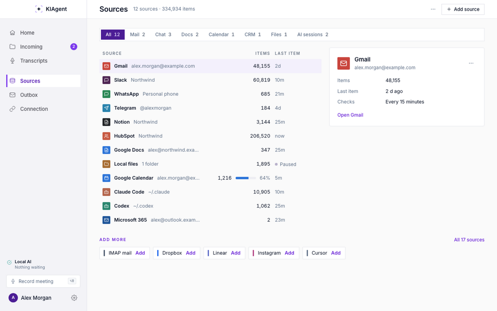
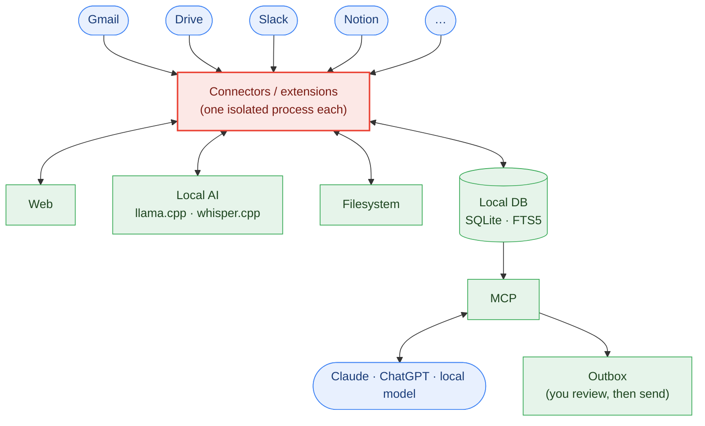

<p align="center">
  
</p>

<h1 align="center">KIAgent</h1>

<p align="center"><strong>An open-source AI operating system for your personal data — local, private, speaks MCP.</strong></p>

<p align="center">
  <a href="https://localkiagent.com/">Website</a> ·
  <a href="https://localkiagent.com/download">Download</a> ·
  <a href="docs/architecture">Architecture docs</a> ·
  <a href="CHANGELOG.md">Changelog</a>
</p>

<p align="center">
  <a href="LICENSE"></a>
  <a href="https://localkiagent.com/download"></a>
</p>

<p align="center">
  
</p>

If you think of a local AI model as the CPU, KIAgent is the rest of the operating system: it gives that model — or any assistant you choose — access to your personal data and to a small set of tools, so it can help with the growing complexity of everyday life.

Your records are spread across mail, chats, calendars and files. KIAgent keeps them in sync on your own computer, converts everything to Markdown on-device, and indexes it in a local database. Looking for your rental deposit agreement? You find both the signed lease and the email that explains it. You can search the index directly, ask a local model, or let an assistant such as Claude or ChatGPT use it over the open [Model Context Protocol](https://modelcontextprotocol.io) — and switch between them whenever you like.

## Why

- **The more connected data an AI has, the more useful it gets.** Handing all of it to one AI provider puts too much power in one set of hands. Copilot, Gemini and ChatGPT connect to your mail and files, but process them in the vendor's cloud and work only with that vendor's AI. KIAgent keeps the index on your machine and serves it to any assistant, including fully local models.
- **Life keeps getting more complex.** An assistant with access to your whole digital life can catch the threads that are slipping through your fingers: the letter that needs an answer, the meeting you promised to follow up, the contract you signed three years ago.
- **Your data should outlive the services that hold it.** Old exports — Google Takeout, Outlook PST, mbox, Evernote — become searchable again instead of sitting unused.

Unlike document chat tools such as AnythingLLM or Khoj, which mostly work on files you add yourself and bring their own chat window, KIAgent keeps live sources in sync and plugs into the assistant you already use.

## What it does

- **Brings your data together, locally.** Gmail, Microsoft 365, IMAP, GitHub and local folders are built in; more connectors (Slack, Notion, Google Calendar, HubSpot, WhatsApp, Telegram, …) install from a GitHub-backed marketplace, or straight from any GitHub repository.
- **Reads every format.** PDF, Office (`.docx`, `.doc`, `.pptx`, `.xlsx`), OpenDocument, EPUB, RTF, HTML, subtitles, and containers that unpack into one document per item: ZIP, Outlook PST, mbox (Thunderbird-aware), vCard, Evernote ENEX.
- **Runs AI on your device.** OCR, image description, speech-to-text and embeddings run locally with open-weight models through [llama.cpp](https://github.com/ggml-org/llama.cpp) and [whisper.cpp](https://github.com/ggml-org/whisper.cpp) (plus Apple Vision and Windows OCR where available). Background work yields to you: it waits while you are on battery or using the machine.
- **Serves it to any assistant over MCP.** Full-text search with gmail-style operators (`from:`, `has:attachment`, `order:newest` …), whole documents with their children (thread messages, attachments, voice-note transcripts), counts, and — for power users — read-only SQL. One click writes the config for Claude Desktop, Claude Code, Cursor, VS Code or Codex.
- **Lets assistants act — with you in the loop.** Assistants can draft emails, replies and calendar events (`draft_message`, `draft_reply`, `draft_event`, `find_free_time`). Every draft lands in an **Outbox** where you see the email exactly as it will arrive, edit it, add attachments, and send now or later. Drafts mirror into Gmail/Outlook, so you can also finish them there.
- **Shows you what the assistant saw.** Every MCP call is recorded in an activity feed you can review, and you can disconnect a client at any time.
- **Works across your computers.** One device leads and writes; others follow as read-only copies that can still connect sources and search. A computer that is busy or on battery can hand OCR, transcription and model calls to a helping device. Folders can be shared between your machines. A `headless` product mode runs the same runtime on a server with no window.

> **Privacy, honestly.** Ingestion, conversion and local AI never leave your machine. If you connect an external assistant (Claude, ChatGPT, …), whatever it retrieves through MCP is sent to that provider — exactly as when you paste it in yourself. Use a local model when that matters.

## How it is built

At its core, KIAgent is a **platform**: a small set of host capabilities (database, local AI, filesystem, web, MCP) wired together by an ingestion engine, plus an extension system that lets sandboxed connectors use those capabilities to bring in new data sources.



Each connector runs in its own process and sees only the capabilities its manifest declares; the host re-checks every call. Connectors pull your data in, local AI processes it, and it lands in the database — which MCP then serves to the assistant you choose.

## This repo: kiagent-core

This repository is the MIT-licensed core that KIAgent is built from, in the same spirit as VS Code and Code-OSS:

- **kiagent-core** (this repo) — the open-source core. `npm run package:oss` produces an unbranded `kiagent-core` build you can run and redistribute under the MIT license.
- **[KIAgent](https://localkiagent.com/)** — the branded, signed product built from this core and distributed at [localkiagent.com/download](https://localkiagent.com/download).

A product composes itself on top of the core through two replaceable files with empty defaults — `src/shared/composition.ts` and `src/renderer/composition.tsx` (routes, screens, sign-in, sidebar) — and `product.json` (branding, bundled extensions, `headless`). See [`docs/architecture/extension-platform.md`](docs/architecture/extension-platform.md).

OAuth-backed sources (Gmail, Microsoft, GitHub) read client credentials from the environment at build time — copy `.env.example` to `.env` and fill in your own client IDs. Without them the app builds and runs, but those sign-ins fail with a "this build has no … credentials" error.

## Main components

- **Runtime** (`src/main/runtime.ts`) — one `createRuntime(host)` builds every service; `main.ts` only adds the window, tray and dialogs, so a headless build runs the same code.
- **Ingestion engine** (`src/main/core/engine`) — pulls batches from sources, converts raw items into indexed documents and commits them, in bounded chunks that yield to foreground work. Built-in sources live in `src/main/sources` (Gmail, IMAP, Microsoft 365, GitHub, local and shared folders).
- **Converter** (`src/main/converter`, `src/main/core/converter`) — runs in its own child process and turns mail, Office files, PDFs, e-books and archives into Markdown, expanding containers (ZIP, PST, mbox, ENEX, vCard) into child documents.
- **Database** (`src/main/core/store`, `src/main/db`) — a SQLite corpus (better-sqlite3, FTS5) with a change feed, written by one writer worker; MCP and UI reads go through a separate read worker.
- **MCP server** (`src/main/core/mcp`, `src/main/mcp`) — one tool registry behind two transports: an HTTP server inside the app on loopback, and a standalone stdio entry point that clients like Claude Desktop spawn directly. Extensions add their own tools. `query_sql` runs in a killable process with bounded results.
- **Outbox** (`src/main/outbound`, `src/main/calendar-out`) — email and calendar drafts written by assistants, the review sheet and link page, scheduled sends, and mirroring into Gmail/Outlook drafts.
- **Local AI** (`src/main/providers`) — a bundled llama.cpp server (backend auto-detection, curated model tiers, embeddings), whisper.cpp with voice-activity detection for speech-to-text, and native OCR (Apple Vision, Windows OCR). An admission gate keeps background work on a low-priority lane.
- **Multi-device** (`src/main/core/sync`, `src/main/core/shared-folders`) — the leader/copy role model, account operations relayed to the leader, shared folders, and lending work to a helping device. The transport between devices is supplied by an extension.
- **Extension platform** (`src/main/platform`, `src/main/marketplace`) — isolated connector processes with a manifest-declared, permission-gated view of the platform (sources, auth, storage, network, secrets, calendar and mail sending). Install from the store, from any GitHub repository (marked "Not reviewed by KIAgent"), or from a `kiagent://install` link. Authors start with [`docs/writing-extensions.md`](docs/writing-extensions.md) and the SDK in [`sdk/`](sdk).
- **Renderer** (`src/renderer`, `src/shared/web-ui`) — the React UI: sources, marketplace, Outbox, connection status, settings and logs.

## Developing

Requires Node 22 or newer.

```bash
npm install
npm start          # run in development (hot reload)
```

Other useful scripts:

```bash
npm test                 # jest test suites
npm run lint             # eslint + prettier
npm run typecheck        # tsc, no emit
npm run vendor:inference:prebuilt # download the prebuilt local AI programs (llama.cpp, whisper.cpp, VAD model)
npm run vendor:inference # the same, plus the macOS builds (whisper-cli, vision helper) — needs Xcode CLT and cmake
npm run package          # build a distributable
npm run package:oss      # build an unbranded kiagent-core distributable
```

The app runs without these, but local AI stays off and Settings → Local AI lists what is missing. `vendor:inference:prebuilt` needs no compiler. On macOS, speech-to-text and the vision helper come only from `vendor:inference`, which builds them from source.

## Repository layout

```
src/main       Electron main process: runtime, engine, store, MCP, outbox, sync, platform, sources, providers
src/renderer   React UI
src/shared     Contracts, composition defaults and UI primitives shared across processes
sdk/           Connector SDK
concept/       Types-only blueprint for the core redesign
docs/          Architecture, extension guides, design specs and plans
native/        Native helper sources (vision/OCR)
scripts/       Build and vendoring scripts
```

## MCP directories

KIAgent is published on the [official MCP registry](https://registry.modelcontextprotocol.io/v0/servers?search=kiagent) as `com.localkiagent/kiagent` (see [`server.json`](server.json)) and listed on Glama:

[](https://glama.ai/mcp/servers/edjafarov/kiagent-core)

## Acknowledgements

KIAgent's on-device inference is powered by **[llama.cpp](https://github.com/ggml-org/llama.cpp)** and **[whisper.cpp](https://github.com/ggml-org/whisper.cpp)**, created by Georgi Gerganov and maintained by the ggml-org community (MIT license). The app bundles prebuilt binaries from their official releases (`npm run vendor:inference` fetches them at build time). Running capable models privately on consumer hardware is only practical because of their work — thank you.

## License

MIT — see [LICENSE](LICENSE).
