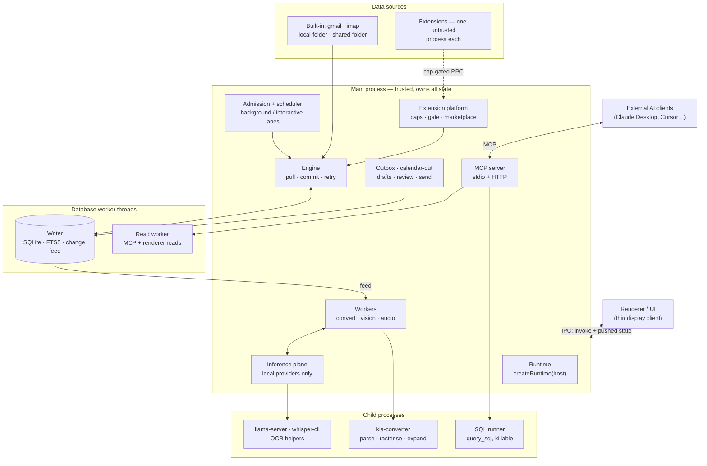

# Architecture

kia is a **local-first personal-data platform**: it continuously pulls your documents
(email, files, chats…) into one local SQLite corpus, enriches them with *local* AI
(OCR, vision, speech), and exposes them to you (UI) and to your AI assistants (MCP).
Core's own inference providers are all local; sending mail or creating events is a separate,
confirmed step (the Outbox).

## The big picture

`src/main/runtime.ts` builds every service once (`createRuntime(host)`); `main.ts` only
supplies the host (window, tray, dialogs, keystore, power state) around it. With
`headless: true` in `product.json` the same runtime runs with no window, tray or dialogs.

Process kinds:

| Process | Trust | Owns |
|---|---|---|
| **Main** | trusted | engine, scheduler, admission, vault access, inference plane, outbox, MCP, all enforcement |
| **Database workers** (`worker_threads`) | trusted | the one writable SQLite connection (writer); a query-only read worker for MCP and renderer reads; a query-only sync worker for deltas and snapshots |
| **Renderer** | sandboxed | display only — invokes commands, consumes one pushed state projection |
| **Extension hosts** | untrusted | one `utilityProcess` per extension; every host call re-checked main-side (bundled `unsafe.mainProcess` extensions run in main) |
| **`kia-converter`** | trusted helper | parsers, PDF rasteriser and container expansion, crash-isolated from main |
| **SQL runner** | trusted helper | the `query_sql` MCP tool, in a process that can be killed on timeout |

(Plus the `mcpStdio` sibling process that stdio clients spawn, and the `llama-server`,
`whisper-cli` and OCR helper children of the local AI providers.)

## The ideas that shape everything

1. **One write primitive.** `Store.commit()` lands documents + cursor + status in a single
   transaction. Sources can crash anywhere; "cursor saved but data lost" cannot be written.
2. **The change feed is the integration bus.** Every commit appends a change; workers and the
   UI projection are just durable feed consumers with their own cursors. At-least-once,
   idempotent by content-hash.
3. **Everything is a plugin — built-ins included.** Gmail and the bundled workers implement the
   same `Source`/`Worker`/`InferenceProvider` contracts (`src/shared/contracts.ts`) that
   extensions do. The contract file *is* the SDK.
4. **Capability-shaped trust.** Extensions run out-of-process and get a host object whose shape
   equals their granted caps; the main-side gate re-checks every call (`CAP_DENIED` + audit).
5. **Local inference only.** OCR, vision, speech and LLM calls run on-device (Apple Vision,
   Windows OCR, llama.cpp, whisper.cpp). Background work passes one admission owner
   (`core/admission.ts`) that weighs battery, user activity and host strength.
6. **The renderer knows nothing.** One pushed `AppState` projection plus a few small
   change hints, every effect an `invoke`.
7. **A product composes itself.** Routes, screens, sign-in, sidebar, the attention
   allow-list and the Sources policy come from two replaceable files
   (`src/shared/composition.ts`, `src/renderer/composition.tsx`) and `product.json`; core
   ships them empty.
8. **One writer, many copies.** A user's devices are one leader that writes and read-only
   copies that apply what it sends (`src/main/core/sync`). A leader can lend whole jobs and AI
   calls to a helper device; it stays the only writer.

## Other subsystems

- **Multi-device** — leader and read-only copies, a lease and write fence decide who writes;
  `src/main/core/sync` holds the role gate, deltas, snapshots and promotion, and
  `src/main/core/shared-folders` the Incoming/Sorted folders the devices share. The transport
  itself is a sync extension that calls `host.sync`.
- **Outbox** — `src/main/outbound` (mail drafts, review, scheduled send, provider-draft
  mirror, per-source senders) and `src/main/calendar-out` (event drafts). Drafts live in the
  `outbox` and `event_drafts` tables; a send or event creation happens only after the draft's confirm step.
- **Attention** — `src/main/attention`: producers publish items, core stores revisions and
  validates where an item may navigate (`ATTENTION_ACTION_POLICY`).
- **MCP** — how AI clients read the corpus, draft messages and events, and refresh sources;
  see [mcp.md](mcp.md).

## Read next

| Doc | Covers |
|---|---|
| [app-shell.md](app-shell.md) | Runtime, `main.ts` host, composition, window-first boot, IPC, renderer state |
| [data-pipeline.md](data-pipeline.md) | Sources → engine → converter → store → workers → inference, admission, lent work |
| [storage.md](storage.md) | SQLite schema, writer/read/sync workers, change feed, FTS, vault, invariants |
| [extension-platform.md](extension-platform.md) | Caps, the gate, extension lifecycle, marketplace |
| [mcp.md](mcp.md) | How AI clients connect; built-in + extension tools |

Deeper design history lives in [`docs/superpowers/specs/`](../superpowers/specs/) and
[`docs/rebuild/`](../rebuild/) (`LEFTOVERS.md` there is a record from the 2026 rebuild;
check the code before treating an entry as open).
