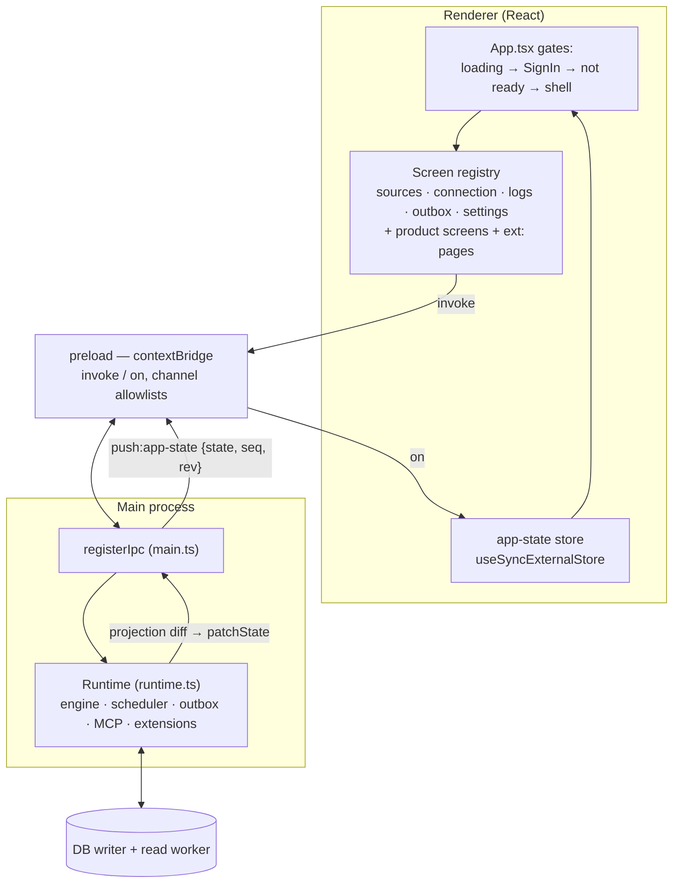

# App Shell & Renderer

The Electron process model, how the runtime boots, and how the UI stays in sync.

## Trust layout

The **main process owns everything stateful and privileged**: the engine and scheduler,
admission, the credential vault, the inference plane, the outbox, extension host processes
and the MCP server. The SQLite file itself is opened by database worker threads that main
talks to over a bridge (see [storage.md](storage.md)). The **renderer is a thin display
client**: it never touches the DB, filesystem or network; every effect crosses
`window.kiagent.invoke(...)`.

## One runtime, a thin host

`src/main/runtime.ts` builds every service. `createRuntime(host)` returns at once with
`{ ready, start, stop }`:

- `ready` resolves to the handles the host needs (platform, extensions, catalog, connect
  broker, outbound, calendar-out, attention, MCP, the last pushed state) once the services
  exist: the MCP listener is bound and the outbox scheduler runs.
- `start(phases)` runs the boot tail (below).
- `stop()` is valid from the first moment and tears down whatever was acquired so far.

`runtime.ts` imports no Electron code. The host supplies `RuntimeHost`: data and asset paths,
the product config, keystore encrypt/decrypt, `env()` (power, thermal, window focus),
an image downscaler, `notifyRenderer`, the tray menu, `confirm`/`inform` dialogs, `notify`
and `trashItem`. `main.ts` keeps what is genuinely Electron: the single-instance lock,
the `BrowserWindow`, the tray, close-to-tray on Windows and Linux, the updater, the
`kiagent://install` link handling, the invoke handler map (`registerIpc`) and the quit shell.
That split lets the same runtime run under jest.

**Headless.** `headless: true` in `product.json` (`src/main/product.ts`) starts the same
runtime with no window, tray or dialogs: `confirm` answers no, `notify` and `inform` write to
the log, and `afterInProcessExtensions` opens no window.

## Composition: how a product shapes the shell

Core ships the empty product. A product replaces these files wholesale:

| File | Supplies |
|---|---|
| `src/shared/composition.ts` | extra routes (`PRODUCT_ROUTES`), the first view, the attention action allow-list, the Sources policy (hidden sources, get-started checklist), and the IPC/push channels its extensions answer (`ProductInvokes`, `ProductPushes`) |
| `src/renderer/composition.tsx` | its screens (`PRODUCT_SCREENS`, merged over core's, so a route id can replace a core screen) and `PRODUCT_SHELL` (own sign-in, sidebar, window frame, root hook) |
| `product.json` | name, update feed, bundled extensions dir, `urlScheme`, `dormantExtensions`, `macUpdatesEnabled`, `headless` |

Main registers no handler for a product's own channels; the extension answers them.
`shared/ipc.ts` folds the product's channel names into the preload allowlists.

## IPC: invoke and push

Defined in `src/shared/ipc.ts`, enforced by runtime channel allowlists in the preload
(`INVOKE_CHANNELS`, `PUSH_CHANNELS`): nothing else crosses the bridge.

- **`invoke`** (renderer → main, request/response): families include `accounts:*`,
  `sources:*`, `search:query`, `docs:*`, `prefs:*`, `identity:*`, `logs:*`, `mcp:*`,
  `marketplace:*`, `extension:*`, `outbox:*`, `calendar-out:*`, `attention:*`, `inference:*`,
  `storage:*`, `scheduler:*`, `maintenance:*`, `update:*`, `app:*`.
- **push** (main → renderer, broadcast): one state channel and a few small ones.
  `push:app-state` (the whole `AppState`), `push:connect` (interactive connect flows),
  `push:logs`, `push:mcp-activity`, `push:update-state`, the payload-free hints
  `push:outbox-changed`, `push:attention-changed`, `push:calendar-out-changed` and
  `push:install-link` (re-read through an invoke), and `ext:push` (an extension's
  `host.ui.broadcast`, fanned out verbatim).

## App state: one pushed projection

`AppState = { accounts, processing, mcp, identity, prefs, extensions, ready }`.

- The **`accounts` slice is feed-derived**: an engine projection tails the store's change feed
  and patches per-account doc counts and recent docs incrementally.
- The other slices are **latched at boot and patched imperatively** (`patchState`): prefs
  changes, extension state changes, and a 5 s processing-counter tick that counts only when
  the ledger moved. `processing` carries the ledger counts, the background `lane` state
  (`open`, `disabled`, `battery`, `until-idle`, `until-night`, `until-synced`), waiting
  visual work, active local model calls and a model download in flight.
- `ready` is `false` in the seeded first state, until the projection's first snapshot lands
  (seconds on a big corpus), so the renderer can tell "still loading" from "no sources".
- Every push carries the whole state plus `{seq, rev}`: `seq` = feed position, `rev` =
  monotonic broadcast counter. Pushes are coalesced (100 ms trailing edge). The renderer
  drops anything with `rev <= lastRev`, reconciles each push against the held state so
  unchanged sub-trees keep their references, and `useAppState(selector)` shallow-compares so
  unrelated slices don't re-render.

## Renderer

- **No router.** A `View` union maps through `screen-registry.tsx`; navigation is component
  state with a back-stack (`state/navigation.ts`). Core's routes are `sources`, `connection`,
  `logs`, `outbox` and `settings` (`state/view.ts` `ROUTE_META`), plus the product's. An
  extension-contributed page is the view `ext:<extension id>/<contribution id>`; its bundle is
  fetched with `extensions:ui-source` and it shows an "unavailable" card unless the extension
  is activated and declares the contribution. The first view is the product's, else `sources`.
- **Gates in `App.tsx`**: no state yet → boot splash; `identity === null` → full-screen
  sign-in (the product's `PRODUCT_SHELL.SignIn` if any); signed in but `ready === false` →
  boot splash again (so a bootstrap state is never shown as "no sources"); then the shell with
  sidebar. Sign-in success is entirely IPC-driven: main re-broadcasts state and the gate flips.
- **Connect flows** (adding an account) are session-scoped: `accounts:add` returns a `flowId`,
  then all interaction (prompts, OAuth status, folder picker) streams over `push:connect`.
  The renderer subscribes *before* invoking and buffers early events, because sources can
  prompt synchronously before the invoke even resolves. On a read-only copy the sign-in runs
  on the copy and the leader commits the result.

## Boot: window first

`main.ts` (`app.whenReady`) creates the runtime, awaits `ready`, creates the tray (not
headless), registers IPC, then calls `runtime.start(...)`.

**Runtime construction** (`createRuntime` build, in order): `bootCore` (logs, prefs, writer and
read workers, store, inference plane, scheduler, admission, converter, engine, sync service);
the attention service; bundled providers (apple-vision, windows-ocr, local-llm and its embed
provider, local-asr) and bundled workers (convert, vision, audio); the outbound and
calendar-out services and the outbox scheduler; the MCP server; the initial `AppState` and
projection; the connect broker and bundled sources (gmail, imap, local-folder,
shared-folder); the shared-folders service; the extension platform; the marketplace
catalog; `engine.project(...)` for the UI projection.

**Boot tail** (`boot-tail.ts`, `runtime.start`), the order the user waits through:

1. Discover and load extensions (a broken `extensions/` dir is logged and never aborts boot).
2. Arm the **boot queue** (`core/boot-background.ts`): accounts whose extension source has not
   registered yet are held and started exactly once when it registers, or released if the
   extension errors, is disabled or removed.
3. Start the in-process (`unsafe.mainProcess`) extensions, waiting at most 5 s
   (`IN_PROCESS_READY_MS`); stragglers are logged.
4. **Open the window** (host `afterInProcessExtensions`).
5. Background chain, never awaited by the window: resume the accounts that can run now
   (`resumeAccounts`), start the scheduler (and the ledger re-key repair), then start the
   utility-process extensions and reconcile the extension set. It aborts on quit or reset.

If a factory reset was interrupted (`reset-journal.ts`), boot instead asks to finish it and
runs the old sequential path: all extensions, resume, scheduler, then the window.

A boot failure goes to `corpus-recovery.ts`: a corpus written by a newer build offers
"quit" or "back up the index and restart on a fresh one"; other failures show a plain error.

**Shutdown.** `before-quit` is intercepted: destroy the tray, `runtime.stop()`, then quit
again. `stop()` aborts the boot chain, then disposes in order: activity watch, outbox
scheduler, processing tick, llama-server and whisper-cli children, MCP, extension hosts,
shared-folder watchers (bounded to 3 s, since open watchers can deadlock quit on macOS),
attention, and finally the database platform. Every step is bounded.

Timing: the **Scheduler** (`core/scheduler.ts`, 30 s tick, durable `last/next_run`)
owns source cadences and maintenance jobs (archive purge, `changes` prune); subsystems
declare cadence as data. Whether background work may run is not the scheduler's call but
admission's (see [data-pipeline.md](data-pipeline.md)). A few service loops keep their own
short timers: the outbox send tick (30 s), the attention tick (60 s) and the processing
counter (5 s).
