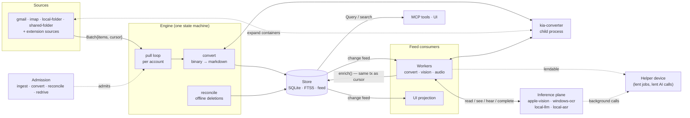

# Data Pipeline

How a document gets from an external system into the corpus, enriched, and searchable.

## Pull: sources feed the engine

A **Source** implements the contract in `src/shared/contracts.ts`: `connect(auth)` for
interactive setup, `pull(session, cursor)` as an async iterable of batches, a *pure*
`toDocument(item)`, optional `fetchBytes` and `reconcile`. The Engine
(`src/main/core/engine/engine.ts`) runs **one pull loop per account**, never two side by side.
The bundled sources are `gmail`, `imap`, `local-folder` and `shared-folder`
(`src/main/sources/`); everything else (Drive, Notion, Slack…) arrives as an extension.

Per account, each cycle:

1. **Trigger**: boot (`resumeAccounts`, or the boot queue for a source whose extension has not
   registered yet) or the Scheduler's 30 s tick when a cadence job is due. Cadence is *data*
   (`{every: '15m'}`); no source owns a timer.
2. **Session**: lazily loads credentials from the vault, auto-refreshing OAuth tokens
   (< 60 s to expiry). No refresh logic exists in any source.
3. **Pull**: batches are consumed abortably; each item goes through `toDocument` then
   **convert** (`engine/convert.ts`): deterministic binary → markdown (PDF, Office, EPUB,
   RTF, CSV/XLSX, subtitles… in `core/converter/`). No inference here; text-poor content stays
   `markdown: null` for the vision worker. Raw bytes are stripped before storage.
4. **Commit**: `store.commit()`: documents + deletions + cursor + status in one transaction.
   Content-hash makes re-pulls no-ops. Each commit appends to the change feed.
5. **Reconcile** (concurrently): sources with `reconcile()` list everything upstream; anything
   live locally but unlisted upstream is archived. A `startSeq` watermark prevents docs
   committed mid-pass from being wrongly archived, and a breaker refuses to archive more than
   half of a large account's live documents in one pass unless the account's config allows it.
6. **Retry**: errors back off exponentially (1 s → 5 min cap, 5 attempts) then park the
   account in `error` until the next trigger. An auth-classed error moves it to `needsReauth`.
   Live sources (IMAP IDLE, folder watch) never end their iterable; cadence sources return and
   wait for the scheduler.

Built-in and extension sources register into the **same registry**: the seam is just who calls
`sources.register()` (`src/main/sources/index.ts` vs the extension platform).

**On a read-only copy** the engine does not run the pull: a leader does (see
[Multi-device](#multi-device)).

## The converter child

Parsing untrusted files runs in the **`kia-converter`** child (`src/main/converter/worker.ts`,
supervised by `core/converter/runner.ts`), so a hostile or huge file cannot take main down.
The converter does four jobs, one request at a time: `parseDetailed` (bytes → markdown),
`parsePdfPages`, `rasterizePdf` (WASM) and `expandPage` (below). The supervisor times jobs out
(doubled on 1-slot hosts), counts crashes, and surfaces `ConverterCrashedError`,
`ConverterTimeoutError` and `ConverterUnavailableError`, which callers treat as "try later"
rather than as a parse result. `KIA_CONVERTER_INLINE=1` (and tests) run the same parsers in
process.

### Containers expand into child documents

A mailbox, archive, address book or note export is read **by path**, a bounded page at a time,
in the converter child: `mbox`, `zip`, `vcard`, `enex` and `pst`. Each page returns children of
type `email.message`, `file`, `contact.card` or `note`, keyed `<container externalId>#<key>`.
The `local-folder` source drives it (`sources/local-folder/expansion.ts`): the scan never emits
the container itself, it records where its expansion stands, and the expander is the only
writer of the container row and its children. A page that fails three times marks the container
failed until it changes; a container held open by another program (Outlook's PST lock) is
retried without spending an attempt; a changed PST waits to be quiet for 10 minutes. A ZIP's
mailboxes, vCards and ENEX members expand too. A bump of `EXPANDER_VERSION` re-expands.

## Admission: one owner of background work

`src/main/core/admission.ts` admits background **units**, each "work in hand plus one bounded
write": `ingest`, `convert`, `reconcile`, `redrive`. Slots come from the host budget
(`core/host-profile.ts`, `HostFacts` read once at boot): **1 slot** on a host with 4 or fewer
cores or 8 GiB or less of memory, otherwise 2 (`KIA_HOST_WEAK=1|0` overrides). Units are
served by kind rank (ingest, convert, reconcile, redrive) with a 5 s aging rule against starvation, and **foreground first**: an
interactive call in flight, or finished within 300 ms, holds new units back (bounded at 10 s). While
the user is active a finished unit keeps its slot a little longer, up to 2 s ("slow mode"), so sync slows but never stops.

Admission also owns the **enrichment lane** that gates vision, audio and model calls, reported
to the UI as `LaneState`: `open`, `disabled` (processing off), `battery`, `until-idle`,
`until-night` (the 22:00-07:00 window) and `until-synced` (a weak host that is still
backfilling). Vision and audio are not units; their heavy work runs in demoted child processes
(`core/child-priority.ts`: `background` children yield CPU and, on macOS, disk I/O).

## Enrich: workers tail the feed

A **Worker** is a durable feed consumer: `matches(change)` (pure) + `work(change, session)`.
The engine tails `store.feed()` from the worker's persisted cursor; delivery is **at-least-once**
so work must be idempotent. Three bundled workers (`src/main/workers/`):

- **convert** parses what commit-time conversion could not: bytes-less attachments (Gmail) and
  binaries that came out text-poor or unparsed, and re-assesses PDFs whose text the current
  quality rules have not judged. It needs no inference, so it is not held to the processing
  window.
- **vision** is the OCR-then-VLM pattern below.
- **audio** transcribes audio files with whisper.cpp (`local-asr`), demand-driven: a candidate
  asks for the model install. wav and mp3 decode everywhere; other formats only on macOS.

The **vision worker** (`src/main/workers/vision/`) is the pattern to copy:

- *Matches*: `attachment`/`file` docs that are PDFs/images with <16 chars of markdown and no
  `metadata.extraction` marker yet (the marker is also the re-entrancy guard: `enrich()`
  re-emits a change, and the worker must not match its own output). Image formats neither OCR
  nor the VLM can open (SVG, DjVu, PSD, icons…) are not visual work.
- *Pass 1*: OCR every page via `session.read()` (apple-vision on macOS, windows-ocr on Windows).
  Good text → `enrich()`.
- *Pass 2*: weak text + decodable image → `session.see()` (local VLM) → merged `enrich()`.
- *Outcomes*: `done` / `skip` / `defer` / `retry` (a final failed attempt is recorded as `failed` in the ledger). `NoProviderError` (model not installed yet)
  and a closed lane → `defer`; the work ledger records `deferred`, and a re-drive job re-offers
  it (through admission as a `redrive` unit) and triggers the model download only when deferred
  work is waiting. A document whose download could not happen (offline, signed out, source not
  registered yet) is re-driven without backoff.
- `emit()`/`enrich()` output commits **atomically with the cursor advance**; a failed final
  attempt commits nothing partial. `session.bump` fences a crash-prone step with a counter
  (`work_attempts`) written outside the batch commit.

## Inference: lanes and providers

`src/main/core/inference.ts` routes `complete` / `see` / `read` / `hear` / `embed` to the first
*ready* registered provider (registration order = priority; a task route can pin a task to
another provider). Two lanes: `interactive` always flows; `background` waits for the
enrichment lane and for foreground idle.

Bundled providers (`src/main/providers/`):

- **apple-vision** (macOS): native Swift Vision helper, `read` (OCR) plus PDF rasterizing.
- **windows-ocr** (Windows): a helper binary, `read`.
- **local-llm**: curated, SHA-pinned GGUF models (sized to RAM/accelerator), resumable
  downloads, out-of-process `llama-server` with health-poll supervision and idle stop. It
  provides `complete` and `see`; its `embedProvider` provides `embed`.
- **local-asr**: whisper.cpp (`whisper-cli`) with a Silero VAD, `hear`, file route used by the
  audio worker.

Inference stays on the user's devices. A call may fail with `LaneClosedError`,
`NoProviderError` or `ModelChangedError` (the model changed under a generation the caller
read); callers treat the first two as "later".

## Multi-device

One device is the **leader** and writes; the others are read-only copies that apply what it
sends (`src/main/core/sync`, spec in `docs/superpowers/specs/`). Role comes from a lease and
a write fence: a restarting leader wakes fenced until it learns it still leads. For the
pipeline this means:

- The pull loop, workers, reconcile and the outbox scheduler run on the leader only; a copy's
  gate holds them and a promotion starts them without a restart (`CorePlatform.promote`).
- A copy can sign in to a source and manage it; the leader commits the result, in one queue per
  account, once per operation id.
- **Lending.** A leader that cannot run background work well hands it to a helper device. A
  worker marked `lendable` (convert, vision, audio) runs there as a *whole job*, unchanged,
  against a session whose bytes and attempt counter come from the leader; its documents and
  enrichments travel back and the leader's engine writes them (`core/lent-work.ts`). A
  background `complete`/`see`/`read`/`hear` call can likewise be answered by a helper
  (`inference.setLender`), only while background processing is on and only with the helper's
  local models. A change whose job is lent and has no helper ready is deferred without
  spending an attempt, and wakes when one appears.
- **Shared folders** (`src/main/core/shared-folders`): the Incoming and Sorted folders belong
  to the account. The leader lists them in `shared_files`, copies mirror them, and the
  `shared-folder` source (one account, leader only) turns the listing into documents.

## Out: query surface

Everything downstream reads through `Query` (`document`, `children`, `byExternalId`, `search`,
`count`, `accounts`): the renderer via IPC, MCP tools, and `query`-capped extensions share the
same read surface, served by the read worker with the writer as fallback. See
[storage.md](storage.md) for schema and search details. Outbound drafts leave through a
separate path, `src/main/outbound` and `src/main/calendar-out`, and re-enter the corpus as
ordinary documents once sent.
