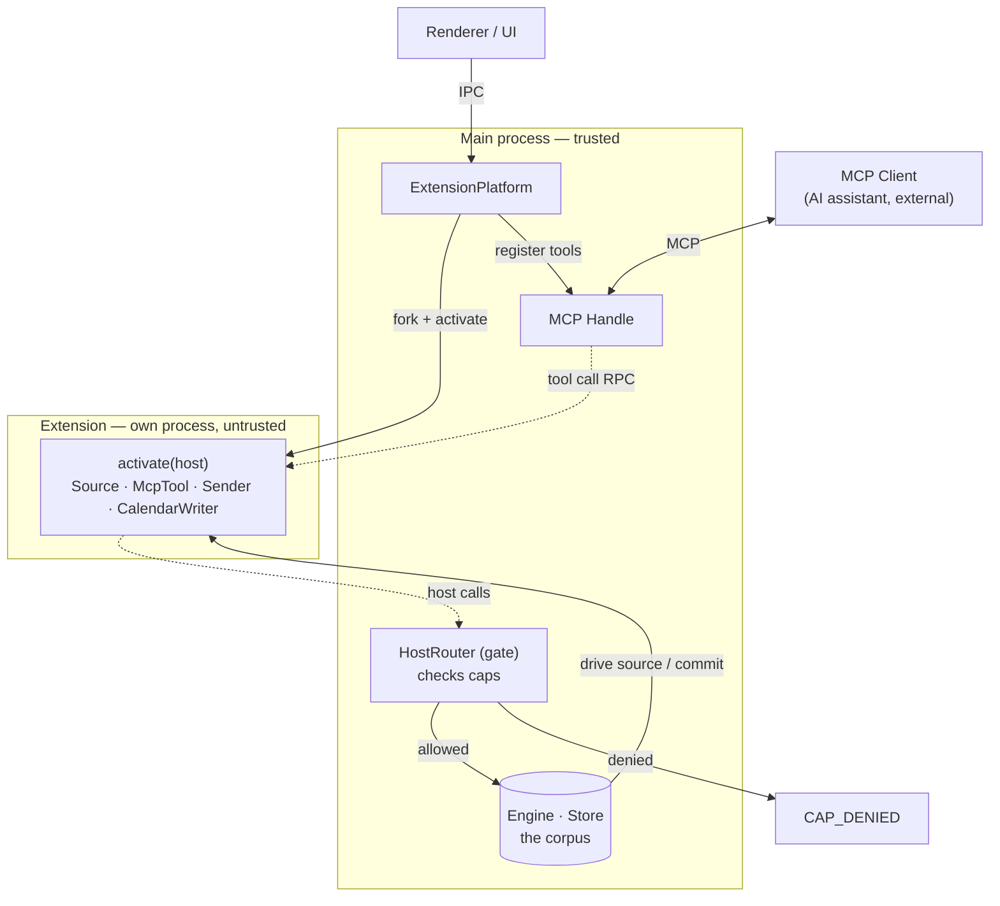
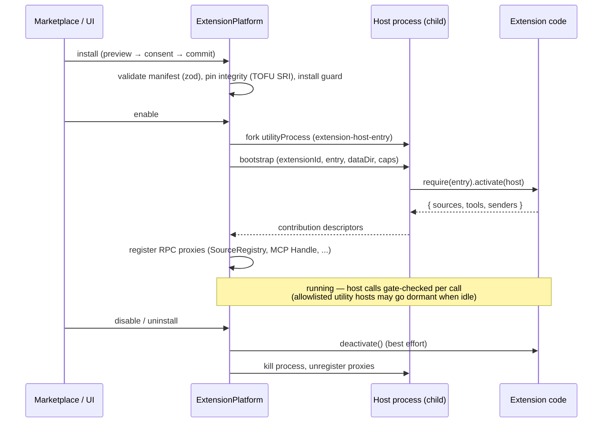

# Extension Platform

How third-party code runs inside kia without being trusted.

## The model in one paragraph

Every enabled extension runs in **its own OS process** (an Electron `utilityProcess`; `child_process.fork` in tests). No extension code ever runs in the main process. The extension declares **capabilities** (`caps`) in its manifest; at runtime it receives a `host` object whose _shape is its grants_ — a namespace it wasn't granted simply doesn't exist on the object. Every host call crosses back into the main process over RPC, where the **HostRouter (the gate)** re-checks the grant before touching anything real. Denied calls throw `CAP_DENIED` and write a `permission-violation` audit log.



## The contract IS the SDK

The extension-facing API is §7 of [`src/shared/contracts.ts`](../../src/shared/contracts.ts) plus
the runtime error classes in [`src/shared/source-errors.ts`](../../src/shared/source-errors.ts),
republished — generated verbatim at pack time — as
[`@kiagent/connector-sdk`](../../sdk/connector-sdk), together with shared utilities (chat-day
rendering, the HTTP retry ladder, a test kit). It ships as a GitHub-release tgz on this repo
(`sdk-vX.Y.Z`); connectors pin it as a devDependency and compile against it. See
[`docs/connectors-authoring-guide.md`](../connectors-authoring-guide.md) and
[`sdk/connector-sdk/README.md`](../../sdk/connector-sdk/README.md). The platform checks the
manifest's `engine` semver range against `PLATFORM_API_VERSION` (`src/shared/extension-rpc.ts`, currently `2.21.0`);
an extension that needs a newer platform is refused with `requires platform <range>; this build is <version>`.

An extension is a CJS bundle whose default export is:

```ts
const extension: ExtensionModule<Caps> = {
  async activate(host) {
    // host has ONLY the namespaces you declared in caps
    return { sources: [...], tools: [...], senders: {...}, calendarWriters: {...} };
  },
  async deactivate() { /* optional */ },
};
```

**Contributions are return values, not registrations.** `activate()` returns contributions; the
main process wraps each in an RPC proxy and registers the proxy into the real registries
(SourceRegistry, MCP Handle, the outbound and calendar pipelines). The extension never holds a reference to anything trusted.

> Note: the contract type and the wire protocol (`Contributions` in `extension-rpc.ts`) agree:
> `{ sources, tools, senders, calendarWriters }` is the whole contribution surface. `senders` and
> `calendarWriters` are keyed by source id and must also be listed in the manifest's
> `contributes.senders` / `contributes.calendarWriters`. A `CalendarWriter` has `listCalendars`,
> `createEvent` and an optional `updateEvent` (platform 2.21.0; a connector without it gets an
> `unsupported:` error from the host). Renderer screens are declared in `contributes.ui`, not returned.

> A contributed tool may set `overview: true`: `digital_memory_info` then calls it with `{}`
> (3 s timeout, 12,000-char cap) and includes the result under `more[<tool name>]`. The flag
> rides the tool descriptor across the host boundary like `tier`; it must answer `{}` fast and small.

## Capabilities

Twelve caps map 1:1 to a host namespace (`CapSurfaces` in contracts.ts; the list is `CAPS` in `src/main/platform/manifest.ts`):

| Cap         | Host surface             | Grants                                                                                                       |
| ----------- | ------------------------ | ------------------------------------------------------------------------------------------------------------ |
| `query`     | `host.query`             | Read the corpus: `document`, `children`, `byExternalId`, `search`, `count`, `countBy`, `accounts`            |
| `net`       | `host.net.fetch`         | Outbound HTTP to public internet destinations only: loopback, LAN, link-local and other reserved ranges are refused (`net-guard.ts`), and a response is capped in size |
| `files`     | `host.files`             | Scoped file access (`roots`, `stat`, `list`, `read`, `write`, `move`, `remove`, `watch`, handles) inside roots the manifest declares in `fileRoots` (home-relative, at most 8, consented at install). Bundled extensions get roots from `mainApi.grantRoot` instead |
| `db`        | `host.db`                | The extension's **own tables** in the shared plugin database, reached through the database worker: `exec`, `query`, `batch`, `transaction`, `migrate`, `identifier`. The manifest must declare `database.schema` (a descriptor of objects and append-only migrations; it may name tables copied between devices). Names are prefixed per extension and a native authorizer limits SQL to them. Not the corpus. A legacy `private.db` in the data dir is imported once |
| `ui`        | `host.ui`                | `notify` for any tier. `handle`, `unhandle`, `broadcast` and `call` (renderer-callable handlers on the `ext:invoke` / `ext:push` channels) are denied to external-tier extensions. Screens are declared in `contributes.ui` and are allowed at any tier |
| `commands`  | `host.commands.register` | Declared in the contract and the manifest, **rejected at runtime today** (`unsupported('commands')`)         |
| `inference` | `host.inference`         | Local AI — see below                                                                                         |
| `events`    | `host.events`            | Cross-extension pub/sub: `on`, `emit` — a listener receives `(payload, meta)`; `meta.from` is host-stamped and cannot be forged by a payload field; names starting `extension.` or `platform.` are reserved for the platform. No filtering, ACL, persistence or replay |
| `attention` | `host.attention`         | `publish` and `resolve` items in the app's attention list; items are validated and scoped to the publisher    |
| `prefs`     | `host.prefs`             | `get`, `set`, `onChange` on the extension's own settings, stored as `<extension id>.<name>` in `user_prefs`, which follows the user to every device. On a follower the leader stores the value |
| `secrets`   | `host.secrets`           | **Bundled tier only.** One account-wide secret per name (`get`, `put`, `onChange`), stored in the vault so it travels to other devices like a login |
| `sync`      | `host.sync`              | **Bundled tier only.** The multi-device sync service: `status`, deltas and snapshots, swap/restore, join, lead/demote, forwarded writes, the AI and work lenders. The method list is `SYNC_SURFACE_METHODS` |

`inference` in detail. `complete` (text), `completeWithMeta` (`{ text, providerId, modelId, firstTokens? }` — who answered, not token usage or truncation), `see`, `read`, `hear`, and `embed` (text to vectors; background lane only), plus:

- `lane()` — the background lane's current `LaneState`, so a caller can wait for `'open'` instead of calling into a closed lane. **Only `'open'` permits background admission; every other value, including ones added later, means closed.** `'until-synced'` is a weak host still in an account's first sync: it stays closed until each source's backfill is followed by a committed `'live'` batch, so a source must commit `live` right after its last backfill batch.
- `describe(kind, { lane? })` — the provider that would answer `kind` now: `{ providerId, modelId, generation }`, or `null`.
- `complete` options: `lane`, `maxTokens`, `system` (a separate system message), `schema` or `grammar` (constrain local decoding; remote providers ignore them), `task`, `budgetKey`, `profile: 'deterministic'` (temperature 0, seed 0, `maxTokens` required and at most 512; repeatable on one machine, not bitwise across hardware) and `generation` (the token `describe()` returned).
- A `lane: 'background'` call fails with `LaneClosedError` while the processing window is closed; a stale `generation` fails with `ModelChangedError` (`{ expected, actual, modelId, source: 'generation' | 'model-drift' }`) before any request reaches the model. **Both cross the RPC boundary by `name`, never `instanceof`** (`src/shared/extension-rpc.ts`), so a caller discriminates on `err.name` and the plain fields.
- Caching: key a persisted result on the canonical request plus the `modelId` from `describe()` taken before the lookup, and pass its `generation` to `complete()`, so a model switch in between becomes a rejected call to repeat rather than a silently wrong hit.
- The `platform.lane` event (via `events`, payload `{ state: LaneState }`) fires on every real transition and once, unconditionally, the first time the publisher runs: that first delivery announces the already-current state.

Three further caps grant **no host namespace at all**:

| Cap                  | Grants                                                                                                                                                                                                                                                                                                                                                                                                                                                       |
| -------------------- | ------------------------------------------------------------------------------------------------------------------------------------------------------------------------------------------------------------------------------------------------------------------------------------------------------------------------------------------------------------------------------------------------------------------------------------------------------------ |
| `send`               | Registration of the extension's `contributes.senders` as outbound transports. Main calls _in_ (`callSender`, and the draft-mirror ops `create` / `update` / `read` / `remove` / `send` for providers that keep drafts), past a confirmation gate; the extension gets no new surface. Bundled senders shadow it. An extension sender's auth-failure `Error.message` ending `reconnect the account in Settings` is classified as retryable-auth by the app's outbound error copy (`src/main/outbound/error-copy.ts`) — a phrasing contract shipped connectors depend on. |
| `calendar.write`     | Registration of the extension's `contributes.calendarWriters`. Main calls `listCalendars`, `createEvent` and `updateEvent` _in_, only after the user confirmed the event (the Outbox or a confirm link); extensions never create events on their own (platform 2.16.0). |
| `unsafe.mainProcess` | Bundled tier only: `activate()` receives `extras.mainProcess`, and the extension runs in-process instead of a forked child.                                                                                                                                                                                                                                                                                                                                  |

Privileged caps (`PRIVILEGED_CAPS` in `manifest.ts`) are `unsafe.mainProcess`, `sync` and `secrets`; an external manifest declaring one is a `ManifestError`.

Always present, no cap needed: `host.self` (`id`, `dataDir`), `host.log(level, msg)` and `host.role.get()`, the one leader fact (`{ leader, follower, multiDevice, epoch, … }`); the platform event `sync.role` fires on every change. Real implementations live in `src/main/platform/host-surfaces.ts`.

### Source options and OAuth providers

A source's runtime `SourceDescriptor` may declare up to 8 boolean `options` (`SourceOption`: `key`, `label`, `description?`, `default`). Core renders each as a toggle on the account page and stores it at `accounts.config.options.<key>`; the connector reads it in `pull`. A source that originates mail sets `compose: 'email'` so `draft_message` can use it.

A `contributes.sources` entry may be `{ id, oauth }`, binding the source to a platform OAuth provider: `google`, `microsoft` or `github` (`OAUTH_PROVIDER_IDS`). The platform owns the provider's profile and token refresh; client secrets stay main-side (`oauth-providers.ts`). Only packages from the store may bind an OAuth provider: a package installed from another GitHub repository or a URL is refused at preview.

Two things worth internalizing:

- **No `db.write` to the shared store exists at all.** Extensions get data into the corpus only
  by _returning_ it — Source pull batches and Worker emissions that the Engine validates and
  commits. The write path is structurally owned by trusted code.
- **Caps are a cooperative contract + audit surface, not OS containment.** The child process can
  still `require('fs')`. The hard gates are install-time (integrity pin, path containment,
  manifest validation) and the main-side check on every host call. This honesty is deliberate —
  see the design spec.

## Lifecycle



Sources contributed by extensions are **demand-driven**: the main-side proxy sends `src-next`,
the child advances the async iterator exactly one step, and replies `src-batch` / `src-done` /
`src-error`. The Engine's backpressure applies to extension sources for free.

**Dormant utility hosts.** A product build may list extension ids in `product.json`
`dormantExtensions` (an audited allowlist of connectors that run no timers, sockets or file
watchers outside a pull). After `DORMANT_AFTER_MS` (5 min) with no call in flight, the platform
soft-stops such a host: the process exits, but its registrations (sources, tools, UI handlers)
stay, and the snapshot reports `dormant`. The next call into it (a pull, a tool, sender or UI call)
respawns the host and waits for `activated`, giving up with `extension is not running` after 60 s.
Bundled and in-process extensions never go dormant; neither does a package installed from outside
the store that claims an allowlisted id. `KIA_DORMANT_HOSTS=0` disables dormancy.

## Runtime files

| File                                        | Role                                                                                                                                                                    |
| ------------------------------------------- | ----------------------------------------------------------------------------------------------------------------------------------------------------------------------- |
| `src/main/platform/extension-platform.ts`   | Orchestrator: per-extension state machine (disabled → activating → activated / needs-consent / errored), install/uninstall/consent, wires contributions into registries |
| `src/main/platform/extension-host-entry.ts` | Child bootstrap: loads bundle via `createRequire`, runs `activate`, dispatches tool/source calls                                                                        |
| `src/main/platform/host-process.ts`         | Per-extension process supervisor: fork → handshake → activate; crash-loop breaker (3 crashes / 60s)                                                                     |
| `src/main/platform/host-router.ts`          | **The gate**: namespace → cap table, `granted: ReadonlySet<Cap>`, throws `CAP_DENIED`, audit log                                                                        |
| `src/main/platform/host-surfaces.ts`        | Real implementations behind each cap namespace                                                                                                                          |
| `src/main/platform/manifest.ts`             | Strict zod manifest validation (unknown keys and caps rejected); `engine` semver check; tier rules for privileged caps; `fileRoots`, `contributes.ui`, `sync` and `database` checks; entry containment |
| `src/main/platform/extensions.ts`           | Disk state only: `installed.json` (ref, integrity, `repoId`), `state.json`, manifest-only discovery — never loads extension code                                         |
| `src/main/platform/extension-set.ts`        | The user's extension set (`core.extensions` in `user_prefs`): what every device installs and enables, with `removed` tombstones for uninstalls                           |
| `src/main/platform/ext-invoke.ts`, `ui-registry.ts` | Renderer-callable handlers (`host.ui.handle`) and contributed screens                                                                                          |
| `src/main/platform/net-guard.ts`, `scoped-files.ts`, `file-roots.ts`, `plugin-db-proxy.ts` | The checks and proxies behind `net`, `files` and `db`                                                          |
| `src/main/platform/oauth-providers.ts`      | OAuth provider profiles/refreshers (`google`, `microsoft`, `github`) — client secrets stay main-side                                                                                      |
| `src/main/platform/source-proxy.ts`         | Demand-driven Source proxying (`src-next` / `src-batch`)                                                                                                                |
| `src/main/platform/transport.ts`            | `utilityProcess` / `fork` / in-memory transports + symmetric RPC endpoint                                                                                               |
| `src/shared/extension-rpc.ts`               | Wire message unions, bootstrap handshake, `PLATFORM_API_VERSION`                                                                                                        |

## Marketplace and other install sources

The store catalog is a GitHub org query (`org:kia-plugins topic:kia-plugin`, 5-minute cache). An
extension can come from three places, and the consent sheet says which (`provenanceOf` in
`src/shared/install-link.ts`):

- **The store** — a repo in the `kia-plugins` org.
- **Any GitHub repo** — pasted as an address in "Add from GitHub", or opened from a
  `kiagent://install?repo=owner/repo[&tag=…]` link (product-gated: the scheme is `urlScheme` in
  `product.json`; the OSS build handles no links). A link never installs anything: it only
  prefills the sheet. The sheet shows **"Not reviewed by KIAgent"** and the publisher's name for
  anything outside the store.
- **A local directory or `.tgz`** — the dev loop (`origin: 'dev'`).

Install is three-phase (two IPC calls, with the consent modal in between on the renderer side):

1. **Preview** (`extension:install-preview`) — download the release `.tgz`, verify/pin integrity
   (TOFU sha512 SRI; plaintext `http:` refs rejected), extract with bounds (entry and byte limits,
   no links), validate manifest, check source-id collisions. No extension code executes.
2. **Consent** — the renderer shows the cap list from the preview; the user approves.
3. **Commit** (`extension:install-commit`) — move staging into `extensions/<id>` (preserving
   `data/`), record the consent row (append-only, in the store), hot-activate.

The installer's guard runs at preview, again before a running extension is stopped, and once more
inside commit:

- A bundled id can't be replaced.
- A package from outside the store can't bind an OAuth provider (`contributes.sources[].oauth`);
  that needs KIAgent's own Google or Microsoft access, which only store connectors get.
- An id already installed from one GitHub repo can't be replaced by another (compared by GitHub's
  numeric repo id, `repoId` in `installed.json`).
- Re-installing the same id+version with different bytes is rejected against the pinned integrity.

**Approved bytes are installed bytes.** On a multi-device account only the leader installs a
store or GitHub package. A follower's commit forwards the pinned ref and the integrity the user
approved (`extension:install`); the leader installs, and if the release asset changed since the
approval it refuses rather than install under the old consent. The other devices follow through
the extension set.

**Uninstall leaves tombstones.** Removing an extension drops its files and, in the extension set,
records `{ enabled: false, removed: true }` so every other device uninstalls it too and a stale
device cannot re-enable it (it must reinstall first). Plugin storage is tombstoned separately
(`plugin_reset_tombstones`) so a retained legacy `private.db` is never imported again. An
extension that still has accounts can't be uninstalled until their sources are removed.

Files: `src/main/marketplace/{catalog,github-source,github-cache,github-ref,installer,update-check}.ts`,
`src/shared/install-link.ts`, `src/main/install-links.ts`; the IPC handlers live inline in
`src/main/main.ts`. The renderer side is `src/renderer/extensions/`.

Authoritative design docs: [`docs/superpowers/specs/2026-07-03-extension-marketplace-design.md`](../superpowers/specs/2026-07-03-extension-marketplace-design.md)
and [`docs/superpowers/specs/2026-11-15-github-install-design.md`](../superpowers/specs/2026-11-15-github-install-design.md).

## Bundled extensions (privileged tier)

A second, optional discovery root lets a **product build** ship extensions
inside the app package itself, alongside the marketplace/dev-installed ones
in `extDir`. It's wired via `ExtensionPlatformDeps.bundledDir` — `main.ts`
resolves it from `product.bundledExtensionsDir` (default
`'bundled-extensions'`) under the resource root; see "Product builds" below.
OSS with no product config still passes a `bundledDir` — it just points at a
directory that doesn't exist, so the bundled scan finds nothing and behavior
is exactly as before.

### Discovery and `origin: 'bundled'`

`ExtensionPlatform.start()` scans `bundledDir` (if set) with
`discoverExtensions(dir, { tier: 'bundled' })` _after_ scanning `extDir`.
Each found entry is tagged `origin: 'bundled'` and gets special treatment:

- **Manifest tier `'bundled'`.** `parseManifest`/`validateManifestDir` take
  an `opts.tier: 'external' | 'bundled'`. Only manifests validated at tier
  `'bundled'` may declare privileged caps (`unsafe.mainProcess`, `sync`, `secrets`;
  `PRIVILEGED_CAPS` in `manifest.ts`); an external manifest declaring one is
  a hard `ManifestError` at parse time: _"this extension requires
  unsafe.mainProcess — only extensions bundled with the app may use it"_
  (the cap names are listed).
- **Auto-consent.** `activate()` skips the consent check entirely for
  `origin === 'bundled'` (`e.origin !== 'bundled' && !(await
consentCovers(...))`). Trust model: consent is a proxy for "the user chose
  to install this"; a bundled extension was never installed — it shipped
  inside the signed app bundle the user already trusted by installing the
  app. There's no separate approval step, ever.
- **No uninstall, no marketplace replace.** `uninstall()` rejects any id
  whose live entry has `origin === 'bundled'` ("bundled extensions are
  part of the app and cannot be uninstalled"), and the installer's guard
  refuses a package whose id is bundled ("...cannot be replaced from the
  marketplace"). A bundled extension _can_ still be disabled
  (`setEnabled(id, false)`) — disable is not uninstall, and `setEnabled` has
  no origin check.
- **Bundled-wins shadowing.** If a bundled id collides with an id already
  discovered from `extDir` (installed/dev), the bundled copy overwrites the
  entry and a warning is logged: _"bundled extension `<id>` shadows an
  installed copy — bundled wins — the installed copy remains on disk and is
  ignored"_. This is boot-time precedence, not a merge — whichever
  manifest/entry the bundled scan found is what runs; the shadowed copy is
  never deleted, just never loaded.
- **`origin` is clamped, never trusted verbatim from disk.** `installed.json`
  is untrusted input (a bare `JSON.parse` cast, no schema validation) — a
  hand-edited record claiming `origin: 'bundled'` must never grant an
  `extDir` extension the auto-consent bypass above. Both Entry-construction
  sites read a record's origin through a clamp that only ever yields
  `'marketplace'` or `'dev'`; `'bundled'` is assigned exclusively by the
  bundled-discovery loop itself, never from a record.
- **dataDir lives outside the app bundle.** Every extension's
  `host.self.dataDir` normally sits at `<extDir-entry>/data`, but a bundled
  extension's install dir is inside the (signed, possibly read-only,
  update-replaced) app package, so it can never double as mutable storage.
  `origin === 'bundled'` entries instead get
  `<bundledDataDir>/<extensionId>`, where `bundledDataDir` defaults to a
  `bundled-extensions-data` directory sibling of `extDir` and is overridable
  via `ExtensionPlatformDeps.bundledDataDir` (`main.ts` points it at
  `userData/bundled-extensions-data`).
- **Settings UI.** The installed-extensions list in Settings leaves out
  bundled entries (`src/renderer/screens/Settings/Extensions.tsx`), so
  there is nothing to uninstall from there.

### The `unsafe.mainProcess` cap

One of three privileged caps (with `sync` and `secrets`, which are host namespaces). It is **not** a host namespace —
`CapSurfaces['unsafe.mainProcess']` is `{}`, and the child runtime's
`NS_METHODS` table (`extension-host-entry.ts`) has no entry for it, so it
never appears on `host` itself. Instead:

- Declaring it in `caps` marks the manifest privileged (rejected outside
  tier `'bundled'`, see above).
- It also selects the transport: `ExtensionPlatform.activate()` checks
  `e.manifest.caps.includes('unsafe.mainProcess')` and, if true, runs the
  extension **in-process** (next section) instead of forking a
  `utilityProcess`/`child_process.fork` host.
- If the platform has a main-process handle for it
  (`ExtensionPlatformDeps.mainApiForPlugin(id)`, which the runtime wires
  to `buildMainApi` in `src/main/main-api.ts` with the caller's id bound;
  the plain `mainApi` dep is the fallback) _and_ the extension declared
  the cap, `activate(host, extras)` receives `extras = { mainProcess:
  mainApi }` as its second argument. Otherwise `extras` is `undefined` —
  including always for out-of-process (forked) children, which never
  receive `mainApi` regardless of caps.
- Consent copy (`CAP_CATALOG['unsafe.mainProcess']`,
  `src/renderer/components/cap-catalog.ts`): label _"Full app access
  (bundled only)"_, risk `elevated`, icon `settings` — _"Runs inside the app
  process with unrestricted access to it. Only extensions shipped as part
  of the app itself can use this."_
- **Explicitly unstable — a temporary escape hatch.** It exists so a
  first-party bundled extension can reach real main-process internals
  before the platform grows a proper capability for whatever it needs
  (identity, extension storage/schema, UI slots — later-stage work). Every
  escape-hatch usage is expected to migrate to a real cap and the hatch
  itself to be deleted; it is not meant to become a general "trust me" cap
  — the manifest tier already forecloses third-party use, since only
  extensions validated at tier `'bundled'` (i.e. shipped inside the signed
  app bundle) may ever declare it.

### In-process semantics (vs. a forked child)

For `unsafe.mainProcess` extensions, `activate()` builds an in-memory
transport pair (`createInMemoryHostPair()`) instead of forking, and drives
the _same_ child-runtime code (`runExtensionHost` from
`extension-host-entry.ts`) directly inside the main process, over that
pair. Two real differences remain, and one that looked like a difference is
neutralized:

1. **The kill backstop is inert.** The primary stop path — the platform
   sends a `'deactivate'` message, the extension's own `deactivate()` runs,
   then the host exits — is identical to the forked tier. Only the
   _backstop_ differs: a forked child that ignores/outlives its deactivate
   gets OS-killed; an in-process extension's `exit` is wired to
   `pair.simulateExit(code)`, which only tells the supervisor "this host
   exited" — it cannot terminate anything. A timer or listener a
   misbehaving bundled extension leaks keeps running in the main process.
   Consequence for authors: `deactivate()` must actually tear down what you
   started — the platform cannot force it for you.
2. **No process boundary for exceptions.** An uncaught exception or
   unhandled rejection in extension async code hits the main process
   directly — there's no child process to crash instead. Acceptable because
   bundled tier is first-party trusted code by definition; this is not a
   hardening gap for third-party extensions, which always run
   out-of-process.
3. **Neutralized: require-cache persistence.** A naive in-process re-run
   would keep the extension's module (and any module-level state) alive
   across disable→enable, since Node's module cache doesn't know the
   extension "left". This is fixed on exit:
   `pair.main.onExit(() => bustRequireCacheUnder(realDir))` deletes every
   `Module._cache` entry keyed under the extension directory's **real,
   symlink-resolved** path (`fs.realpathSync(e.dir)` — needed because e.g.
   macOS's `os.tmpdir()` is itself a symlink, `/var/folders` →
   `/private/var/folders`, so comparing against the raw directory would
   silently never match). The loader used to `require` the entry,
   `loadExtensionModule()`, goes through Node's real `Module._load`
   primitive for the matching reason: under this repo's jest runtime,
   `createRequire(...).cache` is an ephemeral snapshot that recomputes on
   each access (deletions don't stick), and a bare `require`'s `.cache` is
   consulted by jest's own instrumented module registry, not Node's —
   evicting either one does _not_ make a later `require()` reload under
   jest (verified empirically). `Module._load`/`Module._cache` are the
   lower-level primitives `require()` itself is built on, and are real and
   mutable under both jest and plain Node/webpack (this static `import
NodeModule from 'module'` in `extension-platform.ts` is never touched by
   webpack's bundle-scoped require rewriting, since `target:
'electron-main'` externalizes the `module` built-in). Net effect:
   disable→enable loads a fresh module instance, same as a forked child
   getting a fresh process. Documented boundary: the cache-bust is
   **directory-scoped** — module state held in transitive requires
   _outside_ the extension's own directory (e.g. a shared singleton inside
   a core module the extension imported) survives re-activation, because
   only the extension-dir path prefix is evicted.

The two real differences (1 and 2) are meant to retire once a later stage
lands real capabilities for whatever a given bundled extension needs and it
stops declaring `unsafe.mainProcess` — it either moves out-of-process like
every other extension, or the escape hatch itself is deleted once unused.
The require-cache fix (3) is a permanent property of the in-process host,
not a temporary trade-off.

### Product builds

A **product build** is a bundled-extensions consumer with its own brand
identity: `product.json`, resolved by `loadProductConfig()`
(`src/main/product.ts`). Fields — all optional, and the schema is
`.strict()` (an unknown key rejects the whole file):

| Field                  | Type         | Effect                                                                                                                                                             |
| ---------------------- | ------------ | ------------------------------------------------------------------------------------------------------------------------------------------------------------------ |
| `productName`          | string       | User-facing product name. Read by `Notification` titles in `main.ts` and, via the `app:info` IPC response, by the About pane (title + copyright line).              |
| `updateFeedUrl`        | string (URL) | Overrides the electron-builder-baked `app-update.yml` feed (`autoUpdater.setFeedURL`).                                                                              |
| `bundledExtensionsDir` | string       | Overrides the bundled-extensions directory name/path (default `'bundled-extensions'`), resolved relative to the resource root.                                      |
| `macUpdatesEnabled`    | boolean      | Opens the macOS auto-update eligibility gate. Absent/`false` → macOS updates stay `disabled`/`unsigned-macos`. Only a Developer ID-signed product build sets `true`. |
| `dormantExtensions`    | string[]     | Ids of store connectors allowed to go dormant when idle (see Lifecycle). Absent/empty: none.                                                                       |
| `urlScheme`            | string       | The URL scheme the product claims for install links (`<scheme>://install?repo=…`). Absent: no links are handled and nothing is registered with the OS.             |
| `headless`             | boolean      | Runs the same runtime with no window, tray or dialogs (a server).                                                                                                  |
| `testNetExtensionId`   | string       | The one extension allowed the compiled test-build loopback allowance for `net`. Absent: none.                                                                      |

`loadProductConfig(candidates, log?)` **never throws**: it takes the first
candidate whose `product.json` exists (a candidate ending in `.json` is
used as a literal file path; anything else has `product.json` appended),
parses it, and falls back to `DEFAULT_PRODUCT = { productName:
DEFAULT_PRODUCT_NAME }` (`'KIAcore'`, from `src/shared/product.ts` — the one
constant main and renderer share so a pre-`app:info` render cannot show a
different name) on a missing file, parse error, or schema violation (logging the reason via
the optional `log` callback on error, never throwing). `main.ts` calls it
with `[process.env.KIA_PRODUCT_CONFIG, app.isPackaged ?
process.resourcesPath : null, app.getAppPath()]` — so `KIA_PRODUCT_CONFIG`
(a directory or a `.json` file path) always wins if set, then the packaged
resources dir, then the dev app path. The resolved
`product.bundledExtensionsDir` (or the default) is what feeds
`ExtensionPlatformDeps.bundledDir` above.

An OSS checkout with no `product.json` anywhere in the candidate list runs
on `DEFAULT_PRODUCT` and (absent a populated `bundled-extensions/`
directory) has nothing for the bundled scan to find — the whole privileged
tier is dormant unless a product build supplies both the config and the
extensions.

### Product composition

Beyond `product.json`, a product shapes the UI by replacing two files that core ships with empty
defaults: `src/shared/composition.ts` and `src/renderer/composition.tsx`. They declare the
product's routes and screens, the first view, the attention allow-list and the Sources policy, and
its shell (sign-in screen, sidebar, window gate) through `PRODUCT_SHELL`. A product also declares
the IPC channels its extensions answer or push, as `ProductInvokes` and `ProductPushes` (with the
data lists `PRODUCT_INVOKE_CHANNELS` / `PRODUCT_PUSH_CHANNELS`): the window may call or receive
them, core registers no handler for them, and the extension supplies one with `host.ui.handle` and
`host.ui.broadcast` when it activates. Core's copies declare none.
