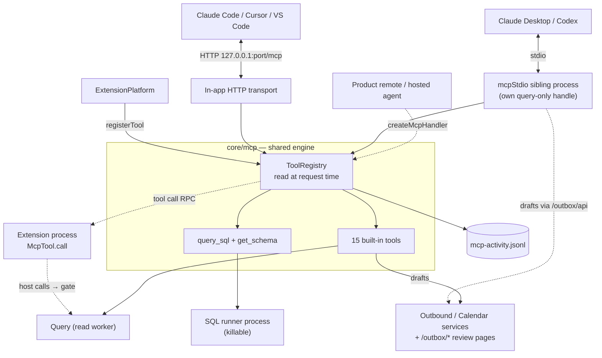
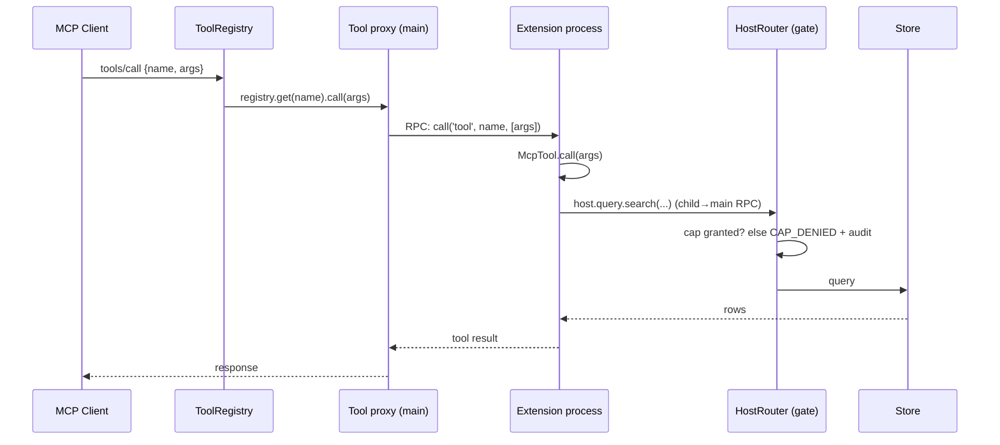

# MCP Surface

How external AI clients (Claude Desktop, Claude Code, Cursor, VS Code, Codex…) read the corpus and
draft outbound messages and calendar events from it.

## One engine, two transports

There are two `mcp` directories, and the split is the whole design:

- **`src/main/core/mcp/`** — the Electron-free *engine*: server identity (`make-server.ts`),
  the mutable **ToolRegistry** + dispatch (`registry.ts`), the built-in tools (`tools/`),
  `doc://{id}` resources (`resources.ts`), the activity feed (`activity.ts`), the `query_sql`
  runner (`sql-runner*.ts`) and client-config writers (`clients.ts`).
- **`src/main/mcp/stdio-entry.ts`** — a *standalone sibling process* that stdio clients spawn
  directly (`ELECTRON_RUN_AS_NODE=1 <app> mcpStdio.js --db <path>`). No window, no single-instance
  lock; it opens its own query-only read handle on the same SQLite file.
- The running app additionally serves **Streamable HTTP** on `http://127.0.0.1:<port>/mcp`
  (`core/mcp/server.ts`). The port is the first free of 7421, 7423, 7424, 7425 (7422 is left to a
  product's own remote server). Loopback bind is the auth — no bearer token — plus a Host/Origin
  allowlist that rejects DNS-rebinding requests with 403.

Both transports import the same registry and tools, so the tool *list* cannot drift between them
(a stdio sibling registers the same tools, but the ones that need the running app say so when
called — see [Drafting](#drafting-and-the-human-review-gate)). The "Connect" button writes the
right client config (`clients.ts`): stdio descriptors for Claude Desktop and Codex, HTTP entries
for Claude Code, Cursor and VS Code. At boot the app rewrites an HTTP entry whose stored URL no
longer matches the port it actually bound.

`serverInfo.version` is the app version, injected at build time through the `__KIA_APP_VERSION__`
define (`make-server.ts`; `0.0.0-dev` when nothing defines it, e.g. under jest).

> Note: `query_sql` and `get_schema` (tier `powerful`) bypass the `Query` path (`tools/raw-sql.ts`).
> In the app, `query_sql` runs in a separate killable runner process (below). The stdio sibling runs
> it in-process on its own query-only connection.

## Built-in tools

Defined in `src/main/core/mcp/tools/`, assembled by `buildBuiltinTools` (`tools/index.ts`) plus
`createRawSqlTools` (`tools/raw-sql.ts`): 17 in all. Fifteen are `tier: 'standard'`; `query_sql` and
`get_schema` are `tier: 'powerful'`.

| Tool | Does |
|---|---|
| `search` | Full-text/boolean search with source/type/date filters, gmail-style operators, batch mode, snippets |
| `get` | Fetch document(s) by id — full markdown + metadata + `source_url`; also lists the document's children (thread messages, attachments, voice-note transcripts, photos) with a snippet each, at most 20, with `children_total` |
| `count` | Aggregate counts (`group_by: source`, also `from`, `label`) |
| `get_related` | Thread messages, attachments, children, parent of a doc; pages past the first 20 children |
| `digital_memory_info` | Discovery: accounts, counts by source/type/language, date range, plus a `more` map with the output of every extension tool that sets `overview: true` |
| `refresh` | Sync a source (or all accounts) now and wait up to 15 s; reports per account synced / still_running / already_running / failed / skipped |
| `draft_reply` | Draft a reply to an email or chat document in the corpus; recipient and threading come from the stored document |
| `draft_message` | Draft a new email to explicit recipients from one of the user's accounts |
| `revise_draft` | Change a pending draft in place, against the revision the caller last saw |
| `list_outbox` | Recent drafts and their status; pending ones carry a fresh confirmation link |
| `send_draft` | Send a draft after the user agreed in chat (chat confirmation mode only) |
| `schedule_drafts` | Set send times for one or many drafts, explicit or spread over a window |
| `list_calendars` | Calendars across connected calendar accounts, with whether each is synced and writable |
| `draft_event` | Draft a calendar event; nothing is added until the user confirms |
| `find_free_time` | Free and "maybe" 30-minute slots across synced calendars and not-yet-added event drafts |
| `query_sql` | Read-only raw SQL (`SELECT`/`WITH` only, textual gate + readonly handle) |
| `get_schema` | Markdown schema doc (tables, columns, relations) — read this before writing `query_sql` |

`query_sql` and `get_schema` ship on both transports. `query_sql` is capped at 500 rows, 64 KiB per
string value and 1 MiB for the serialized result (`tools/query-sql.ts`); cut values and rows are
flagged `truncated`. In the app it runs in one killable runner process (`sql-runner.ts`, spawned
as a utility process; 10 s per query, stopped after 5 min idle): a running SQLite statement cannot
be interrupted from JS, so a query past its timeout is stopped by killing the process, and the
caller gets a message asking to narrow the query.

`tier` is advisory wire metadata (`_meta.tier` on `tools/list`). There is no consent gate behind
`'powerful'`; `query_sql` and `get_schema` are listed and callable like any other tool. The one
tool with an irreversible external effect, `send_draft`, is bounded by the review gate below.

### How calls run

- **Foreground work.** Every `tools/call` and `resources/read` runs as foreground work on the
  app's admission owner, so background ingest and processing yield while a client is waiting. A
  tool opts out with `foreground: false` on its `McpTool`; `refresh` does, because it waits on the
  very background work foreground pauses (`runTool` in `registry.ts`).
- **Reads.** The HTTP server reads through `readsFor('mcp')`, the boot read worker (a read-only
  DB worker with the writer as fallback), so a client read does not queue behind ingest. The stdio
  sibling opens its own query-only connection.
- **Audit and activity.** Every call writes an `mcp.call` log row with redacted args, ok/error and
  duration. It also appends one enriched record (transport `http`, `stdio`, `remote` or `agent`;
  client name; one-line summary; titles touched) to `mcp-activity.jsonl` next to `kiagent.db`
  (`activity.ts`). Both the app and the stdio sibling append; only the app reads it, replaying the
  last 200 records at boot, which is how queries made while the app was closed still count.
  The file rotates at 1 MB.
- **Resources.** `doc://{id}` reads a document's markdown. Nothing is enumerable; clients find ids
  through `search`.
- **Other transports.** `McpServerHandle.createMcpHandler({ transport, allowTools })` returns a
  request handler over the same registry for a product's own remote server (`transport: 'remote'`)
  or a hosted agent (`'agent'`), optionally fenced to an allow-list of tools. `callTool` runs one
  tool in-process with the same fence and audit.

## Drafting and the human-review gate

`draft_reply`, `draft_message`, `revise_draft`, `list_outbox`, `send_draft`, `schedule_drafts`,
`list_calendars`, `find_free_time` and `draft_event` front the Outbound service
(`src/main/outbound/`) and the Calendar-out service (`src/main/calendar-out/`). No tool sends mail
or adds an event on its own account: a draft is a stored row, and the result tells the model what
to show the user and which link to give them.

How a draft is confirmed depends on its **confirm mode** (`ConfirmMode` in `contracts.ts`), frozen
into the draft when it is created:

| Mode | The user confirms by |
|---|---|
| `review` (default) | A full review page served by the app (`/outbox/*`), or the Outbox screen. Link TTL 30 min |
| `link` | Reading the draft in chat, then a short-TTL signed link (5 min) to a minimal Send page |
| `chat` | Saying so in the conversation; the model then calls `send_draft` (and `schedule_drafts` to schedule). A global opt-in in Settings; a per-account setting can opt an account out |

Rules that hold regardless of the client:

- `send_draft` only sends when both the draft's frozen mode and the current mode are `chat`, with
  the draft at the revision the user saw. Chat-mode sends and schedules are subject to a per-account
  hourly send limit. In the other modes `schedule_drafts` only records a suggested time that the
  user confirms per draft.
- A hosted agent (`transport: 'agent'`) always gets `review`, so it can never send.
- A link minted for a remote connection uses the remote base URL; if remote access is not set up,
  drafting over that transport refuses.
- `revise_draft` refuses if the draft changed meanwhile (the user edited it) and returns the current
  draft, so the model never overwrites a human edit.
- A device that holds a read-only copy in multi-device sync refuses `draft_reply`,
  `draft_message` and `revise_draft` with a message naming the device that leads
  (`outbound/follower-tools.ts`).
- `draft_event` adds nothing: the user confirms the event in the Outbox or on the returned link.
  It targets a calendar that Kia can write to (`list_calendars` reports `can_write`).
- The stdio sibling has no senders and no secret, so its drafting tools forward to the running
  app's `/outbox/api` over loopback (`mcp/outbound-proxy.ts`, 90 s per op) and explain if the app
  is not running. `refresh` likewise needs the running app.

## Extension tools

An extension's `activate()` returns `tools`; the platform registers a proxy whose `call` RPCs
into the extension's process. Because the registry is read at *request* time, tools appear to
already-connected clients immediately — no reconnect needed. Registration is first-wins: a name
that is already taken (by a built-in or an earlier extension) is refused and logged.

`McpTool.overview: true` makes `digital_memory_info` call the tool with `{}` (3 s timeout,
12,000-character cap) and include the result under `more[<tool name>]`. The flag crosses the host
boundary in the tool descriptor with `tier`. `foreground` is not part of that descriptor, so a
proxied extension tool is always foreground work.

Details on the extension side: [extension-platform.md](extension-platform.md).
