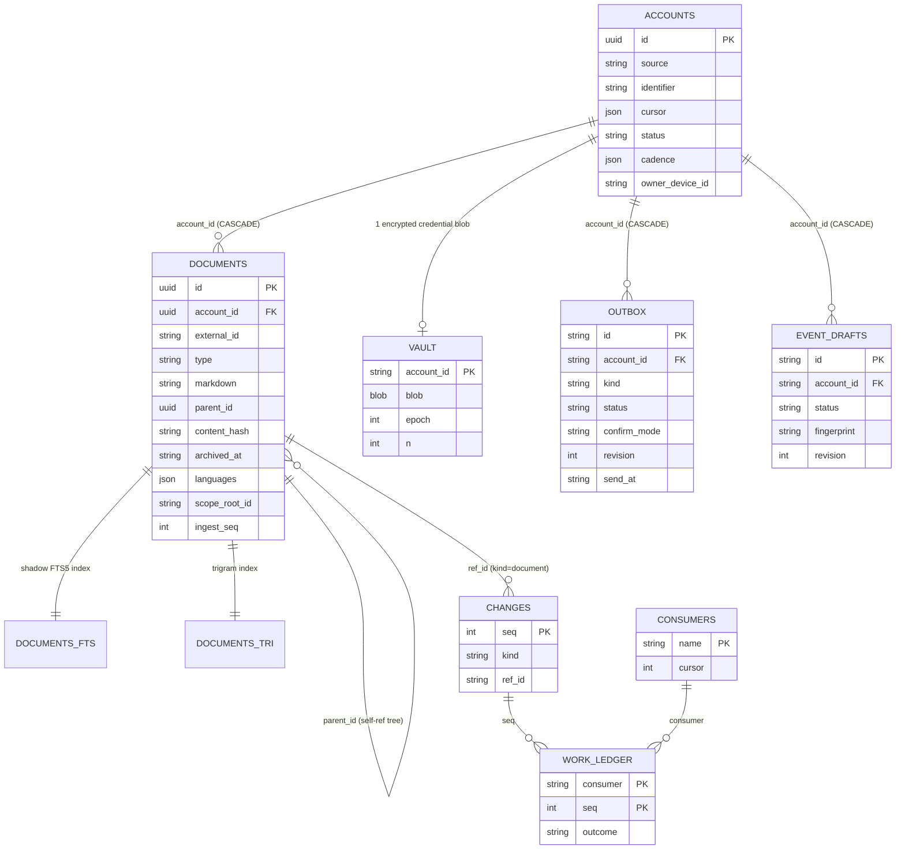

# Storage

One SQLite file (`better-sqlite3`, WAL mode) at `userData/data/kiagent.db` owns everything:
documents, the change feed, credentials, consents, scheduler state, the outbox, attention
state, the multi-device sync state and the tables of extensions that declare a database. The
Store (`src/main/core/store/store.ts`) is the only core code that issues its SQL; extensions
reach their own tables through the platform.

## Who opens the file

The main process never holds a SQLite connection. Database **worker threads**
(`src/main/db/worker-entry.ts`, one bundle, a `role` per instance) do:

| Role | Connection | Used by |
|---|---|---|
| **write** (default) | the one writable connection; runs migrations, the commit transaction, the sync apply, the attention and plugin-database procedures | the Store: every write and any read that needs the latest rows |
| **read** | query-only, no migrations; runs the whole read surface (SQL, stemming, fusion, folding, snippets) | MCP and renderer reads via `core/reads.ts`; opened *after* the writer migrated |
| **sync** | query-only | building deltas and snapshots and hashing for multi-device, so neither ingest nor foreground search waits for them |

`readsFor(caller)` attributes each read (`mcp`, `renderer`, `extension`, `other`) for
`read-diagnostics`. Every reader failure (open failed, crashed, dead) falls back to the
writer, so a read worker problem costs speed, not correctness. A worker crash is retried by
the supervisor in `worker-client.ts`; a crash loop ends in `DB_WORKER_DEAD`.

Two other processes touch the file:

- The **SQL runner** (`core/mcp/sql-runner.ts`) is a killable child that opens the database
  query-only to run `query_sql`: a running SQLite statement cannot be interrupted from JS, so
  the only real stop is a process kill (10 s statement timeout, idle stop).
- The **`mcpStdio` sibling** opens its own read handle (see [mcp.md](mcp.md)).

All writes serialise on the writer thread, behind a coordinator (`db/coordinator.ts`) that
queues core and plugin operations per owner.

## Schema

The schema is **version 25**: `meta.schemaVersion` is the number of forward-only migrations
applied (`MIGRATIONS` in `core/store/schema.ts`). A corpus written by a newer build is refused
at open (`corpus-refusal.ts`; `corpus-recovery.ts` offers to back it up and start fresh).

Tables not drawn:

- **Core state**: `meta` (schema version, user identity), `consents` (append-only cap grants,
  including declared file roots and contributed pages), `schedule` (`job_id`, cadence,
  `last_run`, `next_run`), `work_attempts` (a per-consumer, per-document, per-key attempt
  counter written outside the batch commit), `attention_items` and `attention_revisions`
  (core-owned attention state; revisions outlive payloads so tombstones survive pruning),
  `user_prefs` (user settings that follow the user across devices).
- **Multi-device** (`sync_*`): `sync_state` (one row: role `normal`/`follower`, tracking,
  joining/joined, epoch, device id, the cursor applied), `sync_rows` (the change journal that
  feeds deltas), `sync_epochs`, `sync_moved` and `sync_offers` (logins offered to another
  device), `sync_outbound` (the durable queue for what a device-owned account or an
  extension's `sync.deliver` produced with no leader reachable, including queued settings),
  `sync_retained`, `sync_imported`.
- **Shared folders**: `shared_files` (the leader's manifest of the Incoming and Sorted
  folders) and `shared_capture_files` travel to copies; `shared_mirror` and `shared_pending`
  stay local.
- **Search**: `documents_fts` and `documents_tri` (below).
- **Extensions** that declare a database descriptor get tables in this same file, in a
  namespace the extension owns; a SQL authorizer enforces it, and a descriptor's `synced`
  tables travel between devices.

Which tables leave the leader is explicit (`core/sync/tables.ts`): `accounts`, `documents`,
`outbox`, `event_drafts`, `sync_epochs`, `attention_*`, `user_prefs`, `shared_files` and
`shared_capture_files` are copied; `changes`, `consents`, `consumers`, `meta`, `schedule`,
`vault`, `shared_mirror`, `shared_pending` and the `sync_*` bookkeeping tables stay on their
device. A new core table stays local until it is classified there.

## The rules that matter

- **One write primitive.** `Store.commit(CommitBatch)` lands documents + deletions + cursor +
  status in a *single transaction*, on the writer thread. "Cursor saved but rows not
  committed" cannot be written.
- **Idempotency by natural key.** Documents are `UNIQUE(account_id, external_id, type)`;
  a `content_hash` short-circuit makes re-pulling unchanged items a no-op with no feed churn.
  Sources can be dumb and re-send everything.
- **The feed is the integration point.** Every commit appends to `changes` (append-only,
  AUTOINCREMENT `seq`). Workers and UI projections tail `store.feed(cursor)`; their cursor
  lives in `consumers` and advances *in the same transaction* as their output. Feed rows have
  log-compaction semantics: `document`/`account` rows re-read *current* state at delivery time;
  `purge`/`accountRemoved` are tombstones. A maintenance job prunes `changes` to a bounded
  tail (`maintenance:prune-changes`).
- **FTS is never stale.** `documents_fts` (FTS5, bm25 with title weighted 4×, plus snowball
  stem columns) and `documents_tri` (a trigram index for substring recall) are updated inside
  the same transaction as the row they index. Search text goes through a small hand-rolled
  boolean DSL (`AND`/`OR`/`NOT`, phrases, `prefix*`) compiled to a quoted MATCH expression;
  raw FTS5 syntax is never injected. Because `documents` has a text primary key, `VACUUM` can
  renumber its rowids, so a compact repopulates both search tables.
- **Soft delete, then purge.** Archiving sets `archived_at`; queries exclude archived by
  default. A scheduled job (`maintenance:purge-archived`, every 6 h) hard-purges documents
  archived more than 30 days ago via the `purgeArchived` commit arm; the 30 days also bound
  how long a consumer may lag behind a `purge` tombstone.
- **Credentials are sealed.** OAuth tokens live in `vault` as `safeStorage`-encrypted blobs,
  one per account, encrypted on the main side before they reach the worker. The same table
  holds account-independent secrets under `secret:`-prefixed keys, written only when the OS
  keystore is available (never plain text). Sources never see refresh logic:
  `Session.credentials()` refreshes centrally. On a leader each vault row carries an
  `(epoch, n)` stamp, so an older value never overwrites a newer one on a copy, and a removed
  login travels as an empty blob.
- **Consents are append-only.** Extension cap grants land in `consents`; latest row per
  extension wins. It's an audit trail, not a settings table.
- **A copy writes only what the leader sends.** On a read-only copy the Store's write guard
  throws `SyncReadOnly`, and the applied delta (copied tables, one transaction with its
  cursor) is the only thing that changes them.
- **The outbox is the audit log.** `outbox` and `event_drafts` rows are workflow state, not
  documents: sent, failed, discarded and expired rows are kept. A send reaches the corpus
  again only through normal ingestion of the sent copy. On boot, rows left mid-send or
  mid-create are marked `delivery_unknown` / `unknown` rather than retried blindly.
- **UUIDv7 everywhere.** Time-ordered primary keys for b-tree locality (`src/main/core/ids.ts`).

## Search

FTS5 only: there is **no vector/embedding index** in the core store. (An `embed` capability
exists on the inference plane for extensions; core stores no vectors.) `Query.search` ranks by
bm25; without query text it falls back to recency ordered by *origin* date (`created_at`, else
ingest time), not write order, so newest-first backfills don't invert results. When the exact
pass finds too few hits, a trigram pass appends substring matches (a token matches any document
containing it contiguously; it is not edit-distance typo correction).
